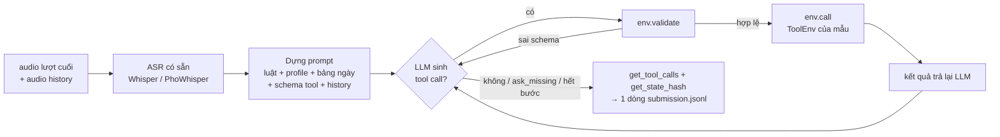

# Pipeline LifeMate: nền móng → tự đánh giá → nâng cấp, và moat để thắng private test

> Tài liệu nghiên cứu cho cả đội. Đọc theo thứ tự:
> **(1)** moat nằm ở đâu → **(2)** pipeline nền móng → **(3)** tự đánh giá → **(4)** đề án nâng cấp → **(5)** 20 câu hỏi để đội trả lời.
> Mọi con số đều đo trên dữ liệu train (2026-10-28), trừ chỗ ghi rõ "giả thuyết".
> Trả lời câu hỏi trực tiếp trong mục 5 (dòng **Trả lời của đội**), commit lên `main`, rồi mang ra thảo luận với Claude.

---

## 1. Nếu ai cũng có AI và tài nguyên như nhau, khác biệt nằm ở đâu?

### 1.1 Nhận định chính

Khi viết code và GPU đều gần như miễn phí, **thứ khan hiếm là tín hiệu đúng và sự hiểu đúng**. Agent AI viết code rất nhanh, nhưng nó tối ưu **bất kỳ tín hiệu nào được đưa cho nó**:
- Đưa cho nó loss trên train → nó học thuộc train.
- Đưa cho nó điểm public leaderboard → nó overfit vào 634 mẫu public.

Đội thắng private test là đội **chọn đúng tín hiệu để tối ưu** và **hiểu đúng thứ đang được chấm**.

Ba lý do cụ thể khiến "train nhiều hơn" không phải là moat ở bài này:

1. **Private test gần như chắc chắn có app mới.** Public đã có 11 app không hề xuất hiện trong train. Model học thuộc 46 app của train sẽ gãy ở app mới.
2. **Điểm số là cổng "được hoặc không" theo state hash.** Một lệnh ghi sai là mẫu đó được 0 điểm. Thứ cần là độ chính xác tuyệt đối ở vài tham số then chốt, không phải "gần đúng nhiều chỗ".
3. **Đáp án được sinh theo một "chính sách" (policy) có quy luật riêng**, và train chỉ là 1545 mẫu của chính sách đó. Đội nào **tái tạo được chính sách sinh nhãn** để áp dụng cho app mới thì thắng. Đội chỉ "train liên tục" thì học được chính sách một cách ngẫu nhiên và không đầy đủ.

### 1.2 Bằng chứng từ dữ liệu: những thứ một đội "vibe coding" sẽ bỏ lỡ

| Phát hiện (đã đo) | Đội làm theo kiểu tự động sẽ… | Đội hiểu bài sẽ… |
|---|---|---|
| Lượt assistant trong history theo **quy ước khác** đáp án (`get_status{room}` 124/167 lần so với `{}` trong đáp án) | Đưa cả history vào train, model học sai quy ước đang bị chấm | Chỉ học từ đáp án; history dùng làm ngữ cảnh hoặc có gắn nhãn riêng |
| Tham số của lệnh ghi: **46%** copy từ kết quả tool, 15% từ history, 15% ngày giờ tự tính, 11% số tự tính, **gần 0%** chép nguyên văn lời nói | Tối ưu WER của ASR | Tối ưu khâu **chọn đúng đối tượng** và **tính đúng ngày giờ, số tiền** |
| Query `contacts.search` là **tên lưu trong danh bạ**: 31/204 chỉ khác chữ hoa ("bác Ba" → "Bác Ba"), 7/204 là tên đầy đủ ("cô Mai" → "Cô giáo Mai") | Không biết vì sao F1 không lên 100 | Biết đây là trần điểm không vượt được, và tự chuẩn hoá chữ hoa |
| Bật đèn mà không `get_status` trước: **cả 11/11 trường hợp** là vì thông tin thiết bị đã có trong history | Coi là nhiễu | Rút ra luật: "đọc trước khi ghi, trừ khi đã có thông tin trong history" |
| `ask_missing_info` luôn là call cuối (217/217) | Để model tự quyết | Dừng cứng bằng code |
| 39% mẫu (605/1545) có tham số của lệnh ghi cần **tính từ lời nói** (ngày, giờ, số) | Để LLM 4B tự tính | Đưa phép tính ra code tất định |

### 1.3 Bảy nguồn moat, và vì sao khó sao chép

1. **Hiểu chính sách sinh nhãn (data-generating process).** Không AI nào tự đọc ra nếu đội không đặt đúng câu hỏi. Đội nào có bảng "luật" rõ ràng (khi nào đọc, đọc có lọc hay không, khi nào hỏi lại, khi nào bỏ qua) thì áp dụng được cho app mới.
2. **Bộ dev mô phỏng private.** Leave-apps-out, sau này có thể thêm leave-groups-out và giọng nói chưa nghe. Có bộ dev đúng thì mọi quyết định sau đều đúng hướng; dev sai thì càng tối ưu càng lệch.
3. **Phân vai giữa LLM và code tất định.** Ngày giờ, số tiền, ràng buộc ID, quy ước call đọc, điểm dừng. Mỗi phần chuyển sang code là một loại lỗi biến mất hẳn, không phụ thuộc vào model.
4. **Dữ liệu tổng hợp đúng chính sách.** Sinh app mới thì dễ; sinh app mới mà **đáp án tuân theo đúng chính sách của BTC** mới khó. Đây là phần tích luỹ, không copy được trong một đêm.
5. **ASR thiết kế theo slot.** Đo và tối ưu lỗi ở số, giờ, tên, từ phủ định ("đừng", "thôi khỏi"), vì đó là chỗ quyết định hash. WER tổng ít liên quan tới điểm.
6. **Vòng lặp phân tích lỗi có phân loại.** Mỗi lần chạy dev ra một bảng lỗi theo nhóm nguyên nhân, sửa có mục tiêu, đo lại. Không "train thêm rồi xem".
7. **Kỹ thuật hệ thống và rủi ro.** Docker chạy offline, trong 30 giây, tái lập qua 5 lần, đúng bản `zaic_tools`. Một lỗi crash là cả bài nộp private về 0. Khi bằng điểm, tốc độ cũng là tiêu chí phân hạng.

---

## 2. Pipeline nền móng: bản đơn giản nhất thoả mãn đề

**Mục tiêu của bản nền móng:** đúng định dạng, đúng luật, có điểm lớn hơn 0, chạy hết mọi mẫu. **Chưa cần chính xác.** Không fine-tune, chỉ ghép các model có sẵn.

### 2.1 Sơ đồ



### 2.2 Năm khối và việc của từng khối

| Khối | Đầu vào → đầu ra | Bản nền móng dùng | File trong repo |
|---|---|---|---|
| 1. ASR | wav → text | Model có sẵn, chưa fine-tune *(chưa làm; hiện dùng `audio_text` của train để đo phần agent)* | `--text asr` trong `infer.py` |
| 2. Dựng prompt | context + history + text → chuỗi ChatML | Schema viết gọn một dòng mỗi tool, bảng ngày từ 7 ngày trước tới 14 ngày sau | `prompt.py` |
| 3. LLM | prompt → `<tool_call>{json}</tool_call>` | Qwen3 zero-shot, greedy | `agent.py` (các backend) |
| 4. Môi trường | tool call → kết quả, state đổi trong bộ nhớ | `zaic_tools.ToolEnv`, một env mỗi mẫu | `infer.py` |
| 5. Vòng lặp + kiểm soát | lặp 3 → 4 tới khi xong | validate trước khi gọi, dừng sau `ask_missing`, tối đa 8 bước | `agent.py` |

### 2.3 Mã giả (toàn bộ bản nền móng)

```python
for item in split:                                   # mỗi mẫu
    env = ToolEnv(split, item.id)                    # đúng 1 env, mọi call đều được ghi log
    text = asr(item.audio); hist = [asr(u) for u in item.history_user_audio]
    msgs = build_prompt(item.context, item.history, hist, text)
    for step in range(8):
        out = llm(msgs)                              # greedy
        calls = parse_tool_calls(out)
        if not calls: break                          # không gọi tool nữa = xong (hoặc ngoài phạm vi)
        results = []
        for c in calls:
            err = env.validate(c)                    # validate KHÔNG bị ghi log
            results.append({"ok": False, "error": err} if err else env.call(c))
            if c.name == "sys.ask_missing_info": stop = True; break
        msgs += [assistant(calls), tool_results(results)]
        if stop: break
    write({"id": item.id, "tool_calls": env.get_tool_calls(), "state_hash": env.get_state_hash()})
```

### 2.4 Đi qua một mẫu thật (`train_0001`)

- **Lời nói:** *"Nếu mai mưa thì dời chạy bộ muộn 1 tiếng, nhắn Sếp Dũng giờ mới; không mưa thì thôi."*
- **Bối cảnh:** bây giờ là 2026-11-28 07:10, nên "mai" là 2026-11-29. App đã cài: weather, calendar, contacts, sms và 10 app khác.

| Bước | LLM sinh ra | Môi trường trả về |
|---|---|---|
| 1 | `weather.get_forecast{date: 2026-11-29}` và `calendar.list_events{}` | `rain: true`; sự kiện `evt_01` "chạy bộ" 08:00–09:00 |
| 2 | `calendar.update_event{event_id: evt_01, start: …09:00, end: …10:00}` và `contacts.search{query: "Sếp Dũng"}` | sự kiện đã dời; danh bạ có `c_08` |
| 3 | `sms.send{contact_id: c_08, content: "mai chạy bộ dời sang 09:00 nhé"}` | tin nhắn đã gửi |
| 4 | "Đã xong." (không có tool call) | dừng → ghi 5 call và hash |

**Mỗi kiểu lỗi trong mẫu này tốn bao nhiêu điểm** (tính theo công thức của BTC):

| Lỗi | Điều gì xảy ra | Điểm của mẫu |
|---|---|---|
| ASR nghe "muộn 1 tiếng" thành "muộn 2 tiếng" | `start` sai → hash sai | **0** |
| Chọn nhầm `evt_02` | hash sai | **0** |
| Gọi `list_events` kèm khoảng ngày thay vì `{}` | hash đúng, 4/5 call khớp | **0,80** |
| Quên tra thời tiết (trời đang mưa nên kết quả ghi vẫn đúng) | hash đúng, khớp 4 trên 5 call của đáp án | **0,89** |
| Nội dung SMS là "Mai chạy bộ dời sang 9 giờ nha sếp" | token-F1 = 0,625 > 0,6 nên vẫn khớp, nhưng suýt trượt | 1,00 |
| Không có lỗi nào | | 1,00 |

**Bài học:** lệnh ghi sai thì mất trắng; call đọc sai chỉ mất một phần; nội dung tự do có biên an toàn khá hẹp.

### 2.5 Thang mốc điểm

| Mức | Mô tả | Điểm trên dev |
|---|---|---|
| 0 | Nộp rỗng mọi mẫu | **7,18** (đã đo) |
| 1 | Nền móng zero-shot: Qwen3-1.7B, text chuẩn của train, chưa có ASR | **~10** trên 10 mẫu thử (chưa tin cậy). Lượt chạy đêm nay đo trên 233 mẫu |
| 2 | + SFT trên đáp án | đang train đêm nay |
| 3 | + code tất định (ngày giờ, số, ràng buộc ID, quy ước call đọc) | chưa làm |
| 4 | + dữ liệu app tổng hợp đúng chính sách | chưa làm, đo bằng `dev_lao` |
| 5 | + ASR thiết kế theo slot (thay text chuẩn bằng ASR thật) | chưa làm; điểm sẽ **giảm** so với mức 4, mục tiêu là giảm ít nhất |
| trần | Phát lại đáp án | 100 |

---

## 3. Tự đánh giá pipeline nền móng

### 3.1 Điều kiện để một mẫu được điểm

Một mẫu chỉ được điểm khi **mọi điều kiện sau cùng đúng**. Nhân xác suất các khâu lại với nhau, điểm tụt rất nhanh.

| Loại mẫu (tỉ lệ trong train) | Điều kiện để được điểm lớn hơn 0 |
|---|---|
| Thực thi (79%) | ASR đúng các slot then chốt **và** LLM hiểu đúng ý định **và** chọn đúng ID **và** tính đúng ngày giờ, số **và** không có lệnh ghi thừa |
| Hỏi thiếu thông tin (14%) | Phát hiện đúng là thiếu thông tin **và** `tool_name` đúng **và** danh sách `params` khớp chính xác **và** các call trước đó không làm đổi state sai |
| Ngoài phạm vi (7%) | **Không gọi bất kỳ call nào**, kể cả call đọc |

### 3.2 Tham số của đáp án đến từ đâu

Đo trên 3399 giá trị tham số không fuzzy của đáp án train; riêng lệnh ghi có 2681 giá trị.

| Nguồn | Mọi call | Riêng lệnh ghi | Khâu phải làm đúng |
|---|---|---|---|
| Kết quả tool ngay trong lượt (ID…) | 38% | **46%** | LLM chọn đúng phần tử trong danh sách trả về |
| History (ID, giá trị cũ) | 13% | 15% | Prompt giữ tool_results của history; LLM nhớ đúng |
| Ngày giờ tự tính | 16% | 15% | Tính "mai, thứ tư, trước 3 tiếng…" |
| Số tự tính hoặc chuẩn hoá chữ thành số | 9% | 11% | "hai triệu tám" → 2800000 |
| Enum hoặc boolean | 9% | 9% | Hiểu ý định |
| Chép nguyên văn lời nói | 10% | **~0%** | Hầu như chỉ là query của call đọc |
| Suy ra cách khác | 5% | 3% | — |

- **Kết luận 1:** lỗi ASR làm hỏng hash chủ yếu qua **số, giờ, ngày** và qua **từ khoá tìm kiếm** (query sai thì chọn sai ID).
- **Kết luận 2:** 61% tham số của lệnh ghi là "chọn từ danh sách" (kết quả tool hoặc history). Có thể dùng **ràng buộc** để ép giá trị phải là một ID đã thấy.

### 3.3 Lỗi quan sát được ở bản zero-shot (Qwen3-1.7B, 10 mẫu)

1. **Bịa dữ liệu:** tự nghĩ ra số điện thoại thay vì gọi `contacts.search`.
2. **Hỏi lại khi lẽ ra phải tự tra:** gọi `ask_missing_info(calendar.cancel_event, [event_id])` thay vì gọi `list_events`.
3. **Trả lời bằng câu chữ:** "Chuyển tiền đã hoàn tất…" mà không gọi tool.
4. **Chế độ suy nghĩ của Qwen3 lai:** nếu không ép khối `<think>` rỗng, model suy nghĩ tới hết 512 token, bị cắt và không gọi được tool nào.

### 3.4 Điểm yếu mang tính cấu trúc của bản nền móng

| Điểm yếu | Hậu quả | Hướng sửa (mục 4) |
|---|---|---|
| Model zero-shot không biết quy ước của đáp án | Call đọc sai dạng, hỏi lại sai lúc | SFT |
| LLM tự tính ngày giờ và số | 39% mẫu có nguy cơ hash sai | Code tất định |
| Không có gì ràng buộc ID | Bịa ID, chọn nhầm ID | Constrained decoding hoặc kiểm tra sau |
| App mới ở private | Không có dữ liệu train | Đổi tên schema + app tổng hợp |
| ASR chưa tối ưu cho số, tên, phủ định | Hash sai dù agent đúng | ASR thiết kế theo slot |
| Chưa đo thời gian và tính tái lập trên A30 | Rủi ro mất trắng bài nộp private | Docker + kiểm thử 5 lần |

### 3.5 Trần điểm không vượt được (giả thuyết, cần kiểm chứng)

- Query `contacts.search` dùng tên lưu trong danh bạ: 7/204 trường hợp agent **không thể biết trước** tên đầy đủ, nên F1 của các mẫu đó dưới 1 dù làm đúng mọi việc khác.
- Server có thể so khớp phân biệt chữ hoa (bộ chấm local đang giả định như vậy). Nếu đúng, thêm 31 query phải viết hoa đúng kiểu tên trong danh bạ.

---

## 4. Đề án nâng cấp (mỗi tầng: giả thuyết → cách đo → chi phí)

| Tầng | Nội dung | Giả thuyết | Cách đo | Chi phí |
|---|---|---|---|---|
| **T1. SFT** *(đang chạy)* | LoRA trên đáp án + tăng cường (đổi tên, gỡ app, app gây nhiễu, transcript kiểu ASR) | Model học quy ước đọc, hỏi lại, ngoài phạm vi | dev_random: so zero-shot với SFT, phân theo loại mẫu | Thấp |
| **T2. Code tất định** | Bộ tính ngày giờ ("thứ tư tuần sau", "trước 3 tiếng"); chuẩn hoá số; ép ID phải là giá trị đã thấy; chuẩn hoá call đọc theo luật; viết hoa query | Xoá hẳn một nhóm lỗi; đặc biệt có lợi cho model nhỏ | Điểm dev trước và sau, bảng lỗi theo nhóm | Thấp–vừa |
| **T3. Tổng quát hoá** | Rút "luật chính sách" từ train thành văn bản; dùng LLM mạnh sinh app mới, simulator, câu yêu cầu và đáp án **theo luật đó**; kiểm chứng bằng cách chạy thật | Điểm `dev_lao` (app chưa thấy) tiến gần `dev_random` | Khoảng cách giữa `dev_lao` và `dev_random` | Vừa–cao, **đây là moat chính** |
| **T4. ASR theo slot** | Fine-tune ASR trên 6,8 giờ train; chuẩn hoá chữ thành số; gợi ý từ khoá theo ngữ cảnh (tên kênh, enum, tên app); đo lỗi slot | Giảm số mẫu sai hash vì ASR | Điểm dev khi dùng text chuẩn so với khi dùng ASR | Vừa |
| **T5. Hệ thống** | vLLM + prefix caching; model 4B; đo thời gian trên GPU 24GB; kiểm thử 5 lần; Docker offline | Không mẫu nào quá 30 giây, kết quả giống hệt qua các lần chạy | Thời gian p99, so sánh từng ký tự 5 lần chạy | Vừa |

**Không nên làm:**
- Leo public leaderboard bằng cách chỉnh tham số theo điểm public.
- Pseudo-label public test (bị cấm).
- Dùng chế độ suy nghĩ dài.
- Nhồi thật nhiều ví dụ mẫu vào prompt thay vì SFT.
- Chọn model sát giới hạn 5B khi chưa đo thời gian.
- Đóng Docker vào phút chót.

---

## 5. Hai mươi câu hỏi cho đội

Mỗi câu gồm: **vì sao quan trọng** và **gợi ý cách tìm câu trả lời**. Có thể trả lời bằng thí nghiệm nhỏ, đọc dữ liệu, hoặc lập luận. Ghi câu trả lời ngay dưới mỗi câu.

### A. Hiểu thước đo và chính sách sinh nhãn

**Q1. Server so khớp tham số không fuzzy thế nào: có phân biệt chữ hoa không, có gộp khoảng trắng không, list có xét thứ tự không?**
- *Vì sao:* quyết định có cần viết hoa query, sắp xếp list `params` của `ask_missing` hay không.
- *Gợi ý:* thiết kế 1–2 lần nộp public **dùng để dò thước đo**, không phải để tối ưu. Ví dụ nộp cùng một bài nhưng viết thường toàn bộ query của call đọc, rồi so điểm.
- **Trả lời của đội:**

**Q2. BTC sinh đáp án như thế nào: bằng template, bằng LLM, hay bằng một simulator chạy chính sách cố định? Tìm thêm dấu vết** (ngoài chuyện query dùng tên trong danh bạ).
- *Vì sao:* biết cách nhãn được sinh thì tái tạo được chính sách cho app mới.
- *Gợi ý:* so sánh nhiều mẫu cùng kiểu yêu cầu; xem tham số fuzzy được viết theo văn phong nào; xem thứ tự các call.
- **Trả lời của đội:**

**Q3. Viết thành luật: khi nào đáp án gọi call đọc trước lệnh ghi, khi nào đọc kèm bộ lọc, khi nào bỏ qua bước đọc?**
- *Vì sao:* call đọc chiếm phần lớn F1, và luật tổng quát dùng được cho app mới.
- *Gợi ý:* thống kê theo từng cặp (call đọc, lệnh ghi); đã biết 113/126 lần bật đèn có `get_status` trước, và 11 lần còn lại đều do đã có trong history.
- **Trả lời của đội:**

**Q4. Ranh giới giữa hỏi lại, tự quyết và bỏ qua: các "tín hiệu" nào dẫn tới `ask_missing_info`?**
- *Vì sao:* 14% mẫu là hỏi lại, và danh sách `params` phải khớp chính xác.
- *Gợi ý:* đọc 217 mẫu hỏi lại, phân nhóm: trùng tên, thiếu giờ, thiếu số tiền, yêu cầu mơ hồ ("hạ xuống chút")… Rút ra danh sách kiểm tra.
- **Trả lời của đội:**

**Q5. Phân loại 111 mẫu ngoài phạm vi theo nguyên nhân. Có mẫu "làm được một phần" không, và đáp án xử lý ra sao?**
- *Vì sao:* gọi dù chỉ một call ở mẫu ngoài phạm vi là mất trắng; còn yêu cầu nhiều ý mà chỉ một ý làm được thì cách xử lý chưa rõ.
- *Gợi ý:* lọc các mẫu có nhiều ý định mà thiếu một app; xem đáp án làm phần còn lại hay trả `[]`.
- **Trả lời của đội:**

### B. Tổng quát hoá và tín hiệu đánh giá

**Q6. Private test có thể khác public ở những điểm nào** (app mới, phân bố loại mẫu, giọng nói, độ dài history)? **Bộ dev nào mô phỏng private tốt nhất?** Leave-apps-out đã đủ chưa, hay cần leave-groups-out?
- *Gợi ý:* so phân bố của public với train (app đã cài, độ dài history, thành phố); đặt giả định "xấu nhất hợp lý".
- **Trả lời của đội:**

**Q7. Dùng 5 lần nộp public mỗi ngày vào việc gì để không overfit?** Đặt quy tắc cho đội, ví dụ "chỉ nộp khi dev nội bộ tăng ít nhất X điểm" hoặc "dành một lần nộp mỗi ngày để dò thước đo hoặc đo ASR".
- **Trả lời của đội:**

**Q8. Nếu điểm dev nội bộ và điểm public lệch nhau, những nguyên nhân nào có thể giải thích, và kiểm tra từng nguyên nhân thế nào?** Ví dụ: ASR thật so với text chuẩn, app mới, khác biệt của bộ chấm, phiên bản `zaic_tools`.
- **Trả lời của đội:**

### C. ASR

**Q9. Lỗi ASR nào thực sự làm mất điểm? Định nghĩa "tỉ lệ lỗi slot" thay cho WER thế nào?**
- *Gợi ý:* từ bảng ở mục 3.2, lấy các tham số của lệnh ghi có nguồn là ngày giờ hoặc số, tìm cụm từ tương ứng trong `audio_text` (ví dụ "muộn 1 tiếng", "hai triệu tám"), rồi đo ASR nghe đúng các cụm đó bao nhiêu phần trăm. Đừng quên từ phủ định: "đừng", "thôi khỏi".
- **Trả lời của đội:**

**Q10. Có dùng được ngữ cảnh hợp lệ để sửa ASR không?** Ví dụ tên app đã cài, enum trong schema, tên kênh, và sau khi agent đọc danh bạ thì sửa lại tên người.
- *Lưu ý:* chỉ được dùng dữ liệu lấy qua tool, không được đọc `state.json`.
- *Gợi ý:* Whisper có `initial_prompt` hoặc hotword; hoặc sửa ở lớp sau, khi so khớp với kết quả tool.
- **Trả lời của đội:**

**Q11. Lượt user trong history có cần ASR chất lượng cao không, hay model nhỏ, nhanh là đủ?**
- *Gợi ý:* trên train, thay transcript history bằng ASR kém hơn (hoặc cố tình làm nhiễu) rồi đo điểm agent giảm bao nhiêu.
- **Trả lời của đội:**

**Q12. Chuẩn hoá chữ thành số đặt ở đâu: ASR xuất thẳng chữ số, một bộ quy tắc riêng, hay để LLM tự hiểu?**
- *Vì sao:* 11% tham số của lệnh ghi là số phải tính.
- *Gợi ý:* thử cả 3 cách trên các mẫu có `amount`, `time`, `phone`.
- **Trả lời của đội:**

### D. Agent và mô hình

**Q13. Phần nào nên chuyển từ LLM sang code tất định, và mỗi phần cứu được bao nhiêu điểm?**
- *Gợi ý:* dùng mục 3.2 làm khung; với từng nhóm (ngày giờ, số, ID, quy ước call đọc), ước lượng số mẫu bị ảnh hưởng × xác suất LLM làm sai.
- **Trả lời của đội:**

**Q14. Có nên ép model chỉ được sinh ID đã xuất hiện trong kết quả tool hoặc history, và chỉ sinh enum hợp lệ** (constrained decoding)? Rủi ro là gì?
- *Ví dụ rủi ro:* chặn nhầm ID hợp lệ được tạo trong lượt; làm chậm suy luận.
- **Trả lời của đội:**

**Q15. Đánh đổi giữa model 4B và 1.7B, LoRA và full fine-tune, có thêm một dòng "kế hoạch ngắn" trước khi gọi tool hay không — trong giới hạn 30 giây và 16K token. Thí nghiệm nào trả lời rẻ nhất?**
- **Trả lời của đội:**

**Q16. vLLM có cho kết quả giống hệt nhau qua 5 lần chạy không (greedy, batch 1, cùng GPU)? Nếu không, khử khác biệt bằng cách nào?**
- *Vì sao:* nếu lần chạy lại của BTC khác kết quả đã nộp, họ lấy trung bình 5 lần, có thể tụt điểm.
- **Trả lời của đội:**

### E. Dữ liệu

**Q17. Làm sao để dữ liệu tổng hợp tuân theo chính sách của BTC chứ không theo "thói quen" của LLM sinh dữ liệu? Kiểm chứng độ "giống thật" ra sao?**
- *Gợi ý:* (a) chỉ train trên dữ liệu tổng hợp rồi đo trên train thật; (b) huấn luyện một bộ phân loại thật/giả; (c) so phân bố số call, tỉ lệ hỏi lại, tỉ lệ ngoài phạm vi.
- **Trả lời của đội:**

**Q18. Đa dạng hoá ngôn ngữ nói thế nào và theo tỉ lệ bao nhiêu?** Gồm phương ngữ, tự sửa giữa câu ("5 giờ, à không, 5 rưỡi"), phủ định, nhiều ý định trong một câu, từ tiếng Anh xen vào. Cần TTS cho ASR hay chỉ cần text cho LLM?
- **Trả lời của đội:**

### F. Kỹ thuật và quản trị rủi ro

**Q19. Liệt kê các kịch bản khiến bài nộp private về 0 hoặc mất nhiều điểm, và cách phòng cho từng kịch bản.**
- *Ví dụ:* Docker cố tải model khi không có mạng; dùng sai bản `zaic_tools`; tràn bộ nhớ ở mẫu dài; quá 30 giây; đường dẫn `/data` sai; mã hoá UTF-8.
- **Trả lời của đội:**

**Q20. Trong 19 ngày còn lại, đâu là đường găng (critical path)? Việc nào hai người làm song song được? Mốc "đóng băng tính năng" đặt ở ngày nào?**
- **Trả lời của đội:**

---

## 6. Cách làm việc tiếp

1. Trong lúc máy của Anh train, cả đội đọc tài liệu này, chạy thử các thí nghiệm nhỏ bằng code trong `lifemate/` (nhánh hoặc PR `agent-pipeline`), rồi điền câu trả lời.
2. Commit câu trả lời lên `main` (tài liệu được commit thẳng vào `main`; code mới phải qua PR).
3. Mở chat với Claude: *"Đọc `JOURNAL.md` và `docs/PIPELINE.md`, đây là câu trả lời của đội…"* → thảo luận → chốt kế hoạch nâng cấp → ghi vào `JOURNAL.md`.
